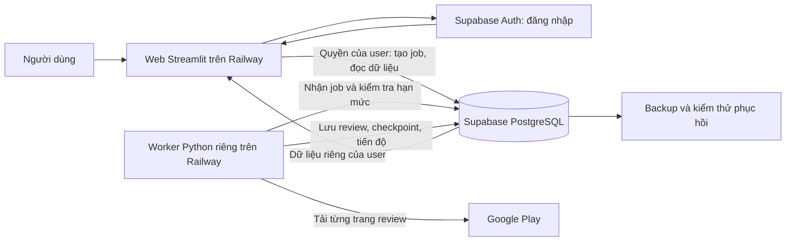

# Mericrawler cho nhiều người dùng: đề xuất để bạn duyệt

**Khuyến nghị: giữ giao diện Streamlit, dùng Railway chạy web và tiến trình crawl riêng, Supabase quản lý đăng nhập và PostgreSQL lưu dữ liệu.** Mỗi người có thư viện riêng trong cùng database. Beta bắt đầu bằng lời mời, có hạn mức sử dụng rõ ràng.

Đây là bản nghiên cứu ngày **23/10/2026**, chưa sửa sản phẩm, mua dịch vụ hay triển khai. Ngân sách, quy mô và hạn mức bên dưới là **đề xuất đang chờ bạn chốt**, không phải khả năng đã đo của app. [Kế hoạch triển khai chi tiết](plan.md).

## 1. Vấn đề cần giải quyết trước khi mở cho nhiều người

Hiện tại mọi người mở app đều dùng chung một file SQLite. Đọc/xóa theo package app, chưa có chủ sở hữu. Luồng thực tế là sidebar gọi đọc danh sách chung; thao tác xóa chuyển thẳng xuống hàm xóa theo package. Vì vậy **thêm màn hình đăng nhập thôi chưa đủ để bảo vệ dữ liệu**. Đã kiểm tra `src/app.py:28`, `src/app.py:88`, `src/app.py:110`, `src/storage/sqlite_store.py:318`.

Web cũng khởi động worker trong cùng process theo mặc định: `src/app.py:60` → `src/app.py:82` → `src/crawl_worker.py:123`. Cần tách ra để đóng tab hoặc cập nhật web không làm gián đoạn crawl.

Cần phân biệt ba con số:

| Khái niệm | Ví dụ | Ảnh hưởng chính |
|---|---|---|
| Tài khoản đăng ký | 100 người có account | Lưu hồ sơ, đăng nhập |
| Người đang xem cùng lúc | 10 người mở bảng/chart | RAM, CPU web, truy vấn database |
| App đang crawl cùng lúc | 2 app được tải review | Tốc độ Google Play, worker, thời gian chờ |

100 account không có nghĩa cần chạy 100 crawl cùng lúc. Hai slot crawl vẫn có thể phục vụ nhiều account bằng hàng đợi. Nếu mỗi job trung bình 10 phút, trần lý thuyết là 12 job/giờ; retry, throttling và lỗi nguồn sẽ giảm con số đó.

## 2. Hệ thống sẽ hoạt động như thế nào?

1. User được mời đăng nhập. Supabase xác minh tài khoản; quyền beta còn hiệu lực được kiểm tra tại database và mỗi lần truy cập, kể cả cache. Tắt đăng ký công khai. Tài khoản bị đình chỉ không được dùng token cũ để tiếp tục.
2. Beta nhận package ID hoặc link Google Play hợp lệ (chưa tìm bằng tên); tối đa 3 dòng/lần và 2.000 ký tự đầu vào. User chọn store, ngôn ngữ và số review. Server kiểm tra quyền và hạn mức rồi ghi một **job** — một yêu cầu crawl — vào database.
3. Nếu đủ slot, worker bắt đầu. Nếu chưa, bảng hiển thị “Đang chờ lượt; hệ thống đang xử lý 2 app”. Không lộ tên app hay tài khoản người khác.
4. Worker tải từng trang, lưu review và **checkpoint** — vị trí tiếp tục nếu bị gián đoạn — trong cùng một lần ghi an toàn. Crawl vẫn tiếp tục khi user đóng tab.
5. Web đọc trạng thái job của đúng user. Bảng hiện số review đã lưu, ngôn ngữ đang xử lý, lần cập nhật và lý do chờ; không giả lập tiến độ 100% khi mới chạm giới hạn.
6. User vào Apps/Insights xem dữ liệu và chart. Database trả từng trang review hoặc số liệu tổng hợp; không gửi toàn bộ lịch sử vào RAM mỗi lần xem.

Giữ bảng crawl hiện tại, **không khôi phục checkbox chọn hàng và khối details đã bỏ**. Đường xem review vẫn qua Apps/Insights. Tham chiếu bảng hiện tại: `src/queue_ui.py:53`, `src/queue_ui.py:78`.

## 3. Dữ liệu user lưu ở đâu? Có cần mỗi user một database?

**Một database PostgreSQL dùng chung, mỗi dòng dữ liệu có `owner_id` xác định chủ sở hữu.** Ví dụ A và B cùng crawl Spotify vẫn có hai thư viện riêng. Xóa dữ liệu của A không xóa của B.

Supabase cung cấp PostgreSQL được vận hành sẵn và Auth; mình không tự xây hệ thống lưu mật khẩu. Database dùng **RLS**, tức quy tắc kiểm tra người nào được đọc/ghi từng dòng. User A gọi trực tiếp API cũng không được lấy dòng của B. Web sử dụng quyền user, không dùng khóa quản trị để đọc dữ liệu khách hàng. [Supabase RLS](https://supabase.com/docs/guides/database/postgres/row-level-security)

Schema dễ hình dung:

| Bảng | Lưu gì? | Ai được truy cập? |
|---|---|---|
| Tài khoản/hồ sơ | User, hạn mức, trạng thái beta | Chủ tài khoản; hạn mức chỉ hệ thống sửa |
| App của user | Chủ sở hữu + package + store | User sở hữu |
| Reviews | Chủ sở hữu + app/store/ngôn ngữ + review ID + nội dung | User sở hữu |
| Crawl jobs | Yêu cầu, cấu hình, tiến độ, lỗi | User sở hữu xem; worker cập nhật |
| Checkpoints | Vị trí tải tiếp của từng app/ngôn ngữ | Worker; cùng phạm vi chủ sở hữu |
| Usage theo ngày | Đã dùng/đã đặt trước bao nhiêu lượt tải | User xem hạn mức mình; hệ thống sửa |

Một review có thể xuất hiện ở nhiều ngôn ngữ/store. Phải định nghĩa rõ “review duy nhất” và “lượt quan sát” để chart không cộng nhầm. Store/ngôn ngữ là ngữ cảnh crawl, không phải quốc tịch xác minh của người review.

Không chia sẻ cache hoặc file export giữa user. Dữ liệu tải về, cache, lịch sử, tên app và thống kê đều phải kiểm tra owner. Cache export hiện tại bỏ dataframe khỏi khóa cache: `src/app.py:320` → `src/app.py:325`; chỉ thêm owner vào SQL mà quên chỗ này vẫn có thể lộ file của user khác.

Chưa cần database riêng từng user, Redis, Kubernetes hay kho dữ liệu phân tích riêng. Cũng chưa tự dùng chung review giữa tài khoản để tiết kiệm, vì điều đó cần chính sách chia sẻ/độ mới dữ liệu rõ ràng.

## 4. Hạn mức beta để không một người dùng hết tài nguyên

Đề xuất bảo thủ dưới đây thay thế các mức minh họa rộng hơn trong báo cáo nghiên cứu; phải chốt sau thử tải:

| Hạn mức đề xuất | Ban đầu |
|---|---|
| Nhóm thử đầu tiên | 20–50 tài khoản được mời; mở thử 5–10 trước |
| Crawl toàn hệ thống | 2 job cùng lúc, một worker process |
| Mỗi user | 1 job đang chạy, tối đa 3 job chờ |
| Một job | 1 ngôn ngữ, tối đa 2.000 lượt review nhận từ nguồn |
| Một ngày/user | 10.000 lượt review nhận, tính cả bản trùng |
| Dung lượng lưu/user | 50.000 lượt quan sát review; cảnh báo ở 80% |
| Giới hạn chống chạy vô hạn | 10 phút/job, 20 trang/job, 60 HTTP attempts/job; hiệu chỉnh sau test |

Quota tính cả bản trùng vì tải lại vẫn tốn tài nguyên. Request lỗi/retry có ngân sách riêng, không chờ có review mới mới tính. Đặt trước ngân sách trong database khi nhận job, quyết toán phần thực dùng và trả phần dư khi kết thúc; hai lượt bấm đồng thời không được vượt hạn mức. Mỗi lần gọi nguồn có mã attempt và ghi ngân sách trước HTTP; tải lại thật sự tính usage mới, chỉ replay cùng lần commit mới không đếm trùng. Nếu crash không biết đã nhận bao nhiêu, giữ charge bảo thủ trong phần đã reserve, không tự refund.

Fetch một trang có thể trả nhiều hơn phần quota còn lại: cần chặn trước bằng reservation đủ trang, tính đủ số nhận và chỉ lưu phần trong giới hạn sản phẩm; thử rõ ranh giới này. Nếu chỉ lưu được một phần trang, không chuyển checkpoint qua phần chưa lưu; lần sau tải tiếp phải không bỏ sót review.

Ngoài quota cá nhân có quota toàn hệ thống: cảnh báo ở 70% ngân sách disk, dừng nhận crawl mới khi dữ liệu đo được cộng phần dự phòng cho job đang chạy đạt 85%; vẫn cho đọc/xóa. 8 GB là mức bao gồm trong giá Supabase, không phải dung lượng miễn phí vô hạn hay hard cap tự ngắt. Đo cả bảng/index và chừa chỗ cho transaction/checkpoint.

Ví dụ giả định 3 KB/observation: 50 người × 50.000 dòng = 7,5 GB; 500 người = 75 GB, chưa phần overhead ngoài giả định. Không thể hứa mọi tài khoản dùng đầy quota mà vẫn nằm trong ngân sách nhỏ. Khi ngưỡng tổng chạm trước quota cá nhân, hệ thống báo tạm dừng crawl; chủ sản phẩm quyết định tăng ngân sách hoặc giảm quy mô, không tự xóa dữ liệu user.

Hàng đợi luân phiên giữa user đủ điều kiện, rồi lấy job cũ nhất của user đó. Không để batch lớn của A chặn B vô hạn. Chạm thời gian/page cap thì lưu checkpoint và ghi **Partial / Đã dừng ở hạn mức**, không báo “đã tải hết”.

Một process hiện giữ một bộ hạn tốc trong `src/crawl_worker.py:129`, rồi claim tại `src/crawl_worker.py:150`. **Chưa bật tự nhân bản worker**: hai process có thể vô tình nhân đôi tốc độ nguồn. Khi mở rộng phải có bộ giới hạn chung và khóa slot trong database, kể cả thời điểm rolling deploy.

## 5. Hosting và chi phí nên chọn

### Lựa chọn đề xuất

- **Railway:** chạy web Python và worker thành hai service. Web không chứa worker nền.
- **Supabase Pro:** PostgreSQL, tài khoản và backup database. Hai service Railway dùng cùng database.
- Chọn vùng gần nhau, đo độ trễ. Hai nhà cung cấp không tự có private network chung.
- Export nhỏ tải trực tiếp; chỉ thêm kho file private khi cần export lớn. Không lưu database/file user lâu dài vào filesystem tạm của web.

Giá kiểm tra ngày 23/10/2026, USD, chưa thuế. Railway hiện khoảng **$10/GB RAM/tháng**, **$20/vCPU dùng trung bình/tháng**, outbound **$0,05/GB**, tính theo 720 giờ. Hobby tối thiểu $5, Pro tối thiểu $20, đều gồm credit tương ứng: bill là `max(mức tối thiểu, usage)`, không cộng trùng. [Giá Railway](https://railway.com/pricing)

Supabase Pro từ **$25/tháng**, gồm một Micro trong credit, 8 GB disk và backup hằng ngày giữ 7 ngày. Free có 500 MB database và có thể pause sau một tuần không hoạt động. [Giá Supabase](https://supabase.com/pricing)

| Kịch bản lập ngân sách, chưa đo tải | Giả định tài nguyên trung bình | Hạ tầng cốt lõi/tháng | Ngân sách nên chuẩn bị |
|---|---|---:|---:|
| Beta nhỏ: 20–50 account, 5 người xem, 2 crawl | Web 0,75 GB + worker 0,5 GB; tổng 0,1 vCPU; 10 GB outbound | ~$45: Railway Pro $20 + Supabase $25 | **$55–75** |
| Beta lớn hơn: 100–500 account, 20 người xem; 2 crawl, chỉ tăng sau test | Web 2 GB + worker 1 GB; tổng 0,35 vCPU; 50 GB outbound; DB Small | ~$69 | **$90–130** |
| Phân tích nặng: không gắn với một số account cố định | Tổng 6 GB RAM, 1 vCPU, 100 GB outbound; DB Medium | ~$159 | Phải đo trước khi chốt |

Đây là mô hình ngân sách, **không phải gói bảo đảm chịu được số người dùng trong bảng**. Phần dự phòng gồm mail đăng nhập/reset, backup độc lập, môi trường test và phát sinh. Chưa gồm domain, công xây dựng, AI trả phí, proxy/dịch vụ crawl ngoài. Xem [công thức và nguồn chi phí](research/costs.md).

### Nếu ngân sách dưới $20/tháng

Có thể làm **demo riêng** bằng Railway Hobby + Supabase Free hoặc giữ SQLite có volume, hạn chế dữ liệu và tự backup. Ví dụ usage web+worker ~$15 trong mô hình nhỏ và DB Free có thể nằm dưới $20, nhưng chưa gồm mail/phát sinh. Free có dung lượng, pause và backup hạn chế; tự vận hành backup mất thêm công.

Không coi đây là mức tương đương bản public có dữ liệu khách hàng và cam kết phục hồi. Nếu ngân sách cứng là $20, giữ beta riêng/demo, giảm tính năng và công bố rõ giới hạn trước.

### Cloudflare và Replit có phù hợp không?

**Chưa chuyển toàn bộ sang Cloudflare.** Workers/Pages không chạy nguyên server Streamlit như Railway; Containers chạy được Python nhưng thêm quản lý lifecycle và routing. Mô hình hai container nhỏ chạy cả tháng cộng Supabase khoảng $49 trước phát sinh, không chứng minh rẻ hơn beta Railway. [Containers pricing](https://developers.cloudflare.com/containers/platform/pricing/), [Python Workers](https://developers.cloudflare.com/workers/languages/python/how-python-workers-work/)

Cloudflare phù hợp bổ sung domain/DNS và kho file R2 sau này. R2 không thay PostgreSQL cho lọc review/chart. Replit Reserved VM vẫn là lựa chọn nếu bạn đang trả tiền ở đó; cần kiểm tra project, credit thực còn lại và cách tách worker. Chưa có thông tin hosting hiện tại để tính phương án giữ Replit chính xác. [Replit billing](https://docs.replit.com/billing/deployment-pricing)

## 6. Tránh mất dữ liệu và hóa đơn bất ngờ

- Backup database hằng ngày + bản sao độc lập có mã hóa. **Mục tiêu đề xuất:** mất tối đa 24 giờ dữ liệu (RPO), khôi phục dịch vụ trong 4 giờ (RTO). Đây là mục tiêu cần diễn tập, không phải SLA đã có. Backup database không tự gồm nội dung file export trong Storage. [Supabase backups](https://supabase.com/docs/guides/platform/backups)
- Thử phục hồi khi web/worker tắt; vô hiệu lease cũ, cách ly job chưa xong và kiểm lại quota. Áp lại danh sách xóa/đình chỉ phát sinh sau backup từ nhật ký độc lập trước khi mở. Thiếu nhật ký thì giữ bảo trì để đối soát, không tự chạy job cũ. Backup tồn tại nhưng chưa restore thử chưa đủ.
- Xóa app/account phải dừng job, thu hồi quyền ghi, xóa dữ liệu và cache đúng owner; worker cũ không được ghi lại sau xóa. Backup hết hạn theo lịch công bố, không hứa xóa mọi bản sao ngay tức thì.
- Đề xuất retention: reviews giữ tới khi user xóa hoặc chạm quota; export lớn tự xóa sau 24 giờ; log vận hành 14 ngày không chứa nội dung review/token; backup độc lập 7 ngày. Cần chốt trước triển khai.
- Cảnh báo ngân sách ở 50%, 80%, 100%; khi gần trần dừng nhận crawl mới trước, vẫn cho xem dữ liệu nếu tài nguyên cho phép. Hard cap của nhà cung cấp có thể làm app dừng, không bảo đảm uptime bằng một công tắc chi phí.
- Không crawl tự động theo lịch, không Full history vô hạn, không bật AI phân tích trả phí trong beta mặc định.

## 7. Thực hiện theo ba giai đoạn có cổng kiểm tra

| Giai đoạn | Kết quả | Chỉ hoàn tất khi | Nếu lỗi |
|---|---|---|---|
| 1. Tài khoản và dữ liệu riêng | Auth, Postgres, owner/RLS, đường đọc/ghi, cache/xóa an toàn | A/B không đọc, sửa, xóa, export lẫn nhau; gọi trực tiếp API cũng bị chặn | Giữ bản hiện tại ở chế độ riêng; chưa mở beta |
| 2. Queue công bằng và Analytics có giới hạn | Worker riêng, quota giao dịch, checkpoint, phân trang/tổng hợp | Job crash rồi chạy lại không mất trang/không quyết toán trùng cùng attempt; user không chiếm hết slot | Dừng nhận job mới, giữ dữ liệu; rollback worker tương thích DB |
| 3. Migration, hosting và thử tải | Chuyển dữ liệu cũ, deploy thử, backup/restore, báo cáo tải | Dữ liệu cũ đúng chủ; restore đạt mục tiêu; tải mục tiêu đạt và budget được đo | Đưa beta vào bảo trì, rollback app/worker; không đổ data nhiều user ngược về SQLite chung |

Thứ tự bắt buộc **1 → 2 → 3**. Các file chung được bàn giao tuần tự; không hai người sửa cùng file ở hai phase song song. Ước lượng chuẩn bị kỹ thuật **60–90 giờ tập trung**, có thể đổi sau PoC đăng nhập và dữ liệu; không phải cam kết lịch giao.

Migration: bật maintenance chặn mọi enqueue/sync/delete từ web và dừng worker sau khi ghi xong trang, rồi backup SQLite nhất quán, nhập dữ liệu về **một tài khoản chủ do bạn chọn**, kiểm số dòng và mẫu nội dung; tuyệt đối không gán toàn bộ dữ liệu cũ cho mọi user mới. Giữ bản cũ riêng để đối chiếu. Review cũ thiếu store/ngôn ngữ nằm trong nhóm legacy/unknown, không tự gán US/en. Không resume cursor thiếu ngữ cảnh; cho bắt đầu lại an toàn sau khi user chọn context.

Thử tải ban đầu: 5 rồi 20 người xem cùng lúc, 2 crawl; mỗi dataset 1.000/50.000 dòng; fixture 100.000 dòng chỉ để stress test ngoài quota beta. Mục tiêu đề xuất trên mạng test: p95 mở bảng ≤2 giây, chart ≤4 giây, nhận job ≤2 giây, tỷ lệ lỗi app <1%, không rò rỉ dữ liệu. p95 nghĩa là 95% thao tác nhanh hơn mốc đó. Chỉ công bố số user hỗ trợ sau khi có báo cáo đo và cấu hình cụ thể.

## 8. Khi nào mới viết lại React/API?

Giữ Streamlit để kiểm chứng sản phẩm. Xem xét frontend React và API riêng nếu sau phân trang, aggregate SQL và điều chỉnh tài nguyên, bài test mục tiêu vẫn không đạt p95/RAM; hoặc nhu cầu mobile, chia sẻ workspace, API khách hàng bị giới hạn rõ bởi Streamlit. Quyết định dựa trên đo đạc và yêu cầu, không dựa riêng vào mốc “100 account”.

Có thể chuyển UI sau vì dữ liệu, auth và job đã tách. Chưa thêm microservices ngoài web/worker/DB và chưa tự động nhân bản worker khi chưa có limiter chung.

## Những quyết định đang chờ bạn

1. **Ngân sách:** dưới $20 cho demo riêng, hay chấp nhận khoảng $55–75/tháng cho beta có dữ liệu thật? Giá trong nghiên cứu là USD; chưa chốt hard cap.
2. **Quy mô thử đầu:** bao nhiêu người được mời, bao nhiêu người dự kiến mở cùng lúc và nhu cầu reviews/ngày? Mặc định nghiên cứu 20–50 tài khoản (mời 5–10 trước), 5 người xem cùng lúc, 2 crawl.
3. Tài khoản cá nhân có đủ chưa, hay phải chia sẻ workspace cho team? Mặc định cá nhân; dữ liệu riêng.
4. Có chấp nhận hạn mức ban đầu, retention và phục hồi mất tối đa 24 giờ không? Có cần lưu lượng lớn hoặc crawl tự động không?

Các lựa chọn chưa trả lời vẫn là pending. Không mua gói, tạo tài khoản dịch vụ hay deploy từ bản plan này.
